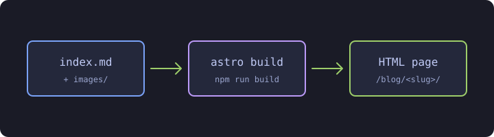

Bài viết này vừa là hướng dẫn, vừa là trang để thử nghiệm. Nó giải thích cách thêm một bài viết mới vào trang và trình bày mọi kiểu định dạng mà một bài viết có thể dùng. Mỗi mục đều có phần Markdown bạn cần viết, ngay sau đó là kết quả hiển thị.

## Tạo bài viết mới

Mỗi bài viết nằm trong một thư mục riêng bên trong `src/content/blog/`. Tên thư mục chính là đường dẫn (URL) của bài, còn ảnh của bài được đặt ngay bên cạnh, trong thư mục `images/`.

```text title="src/content/blog/"
my-new-post/
├── index.md       # Nội dung bài viết
└── images/        # Ảnh chỉ dùng cho bài này
    └── diagram.png
```

Ví dụ, bài viết này là file `src/content/blog/how-to-write-a-blog/index.md` và có địa chỉ `/blog/how-to-write-a-blog/`.

> [!TIP]
> Đặt tên thư mục bằng chữ thường, không dấu, nối các từ bằng dấu gạch ngang (ví dụ `kubernetes-networking`), để đường dẫn dễ đọc và dễ chia sẻ.

### Frontmatter

Mỗi file `index.md` bắt đầu bằng một khối frontmatter nằm giữa hai dòng `---`. Khối này được kiểm tra khi build: thiếu tiêu đề hay ngày viết sai định dạng sẽ khiến build báo lỗi, thay vì tạo ra một trang hỏng.

```yaml title="index.md"
---
title: Kiến trúc của một Kubernetes Cluster
description: Control plane và các worker node phối hợp với nhau như thế nào.
pubDate: 2026-10-27
updatedDate: 2026-11-02   # không bắt buộc
tags: [kubernetes, architecture]
draft: false              # không bắt buộc, mặc định là false
---
```

| Trường | Bắt buộc | Mô tả |
| --- | --- | --- |
| `title` | Có | Tiêu đề bài viết, hiển thị ở đầu trang |
| `description` | Có | Tóm tắt trong một câu, hiển thị dưới tiêu đề và trong danh sách bài viết |
| `pubDate` | Có | Ngày đăng, viết theo dạng `YYYY-MM-DD` |
| `updatedDate` | Không | Ngày cập nhật đáng kể gần nhất |
| `tags` | Không | Danh sách tag; mỗi tag có một trang riêng trong `/blog/tags/` |
| `draft` | Không | `true` sẽ ẩn bài khỏi trang chính thức; bài vẫn hiện khi chạy `npm run dev` |

### Xem trước trong lúc viết

Chạy dev server rồi mở bài viết trên trình duyệt. Trang sẽ tự tải lại mỗi khi bạn lưu file.

```bash title="Terminal"
npm run dev
# mở http://localhost:4321/personal-portfolio/blog/my-new-post/
```

## Tiêu đề và mục lục

Dùng `##` cho các mục và `###` cho các mục con. Cả hai sẽ tự động xuất hiện trong mục lục nằm bên cạnh bài viết. Trên màn hình nhỏ, mục lục được mở bằng nút ở góc dưới bên phải. Không dùng một dấu `#`, vì tiêu đề bài viết đã là heading chính của trang.

```md
## Tên mục
### Tên mục con
#### Tiêu đề nhỏ (không hiện trong mục lục)
```

## Định dạng chữ

| Kiểu | Markdown | Kết quả |
| --- | --- | --- |
| In đậm | `**in đậm**` | **in đậm** |
| In nghiêng | `*in nghiêng*` | *in nghiêng* |
| Vừa đậm vừa nghiêng | `***cả hai***` | ***cả hai*** |
| Gạch chân | `<u>gạch chân</u>` | <u>gạch chân</u> |
| Gạch ngang | `~~gạch ngang~~` | ~~gạch ngang~~ |
| Tô nền | `<mark>tô nền</mark>` | <mark>tô nền</mark> |
| Code trong dòng | `` `kubectl get pods` `` | `kubectl get pods` |
| Phím bấm | `<kbd>Ctrl</kbd> + <kbd>C</kbd>` | <kbd>Ctrl</kbd> + <kbd>C</kbd> |
| Chỉ số dưới | `H<sub>2</sub>O` | H<sub>2</sub>O |
| Chỉ số trên | `2<sup>10</sup>` | 2<sup>10</sup> |

Markdown không có cú pháp riêng cho gạch chân, tô nền hay phím bấm, nên các kiểu này dùng thẻ HTML. Thẻ HTML dùng được ở bất kỳ đâu trong bài.

### Chữ màu

Bọc đoạn chữ trong thẻ `<span>` với một trong các class màu dưới đây. Màu sẽ tự đổi theo giao diện sáng hoặc tối.

```md
- <span class="text-red">Lỗi: pod đang ở trạng thái CrashLoopBackOff</span>
- <span class="text-green">Deployment đã rollout thành công</span>
- <span class="text-blue">Thông tin: 3/3 replica đang chạy</span>
- <span class="text-yellow">Cảnh báo: image đang dùng tag "latest"</span>
- <span class="text-purple">Cần quyền cluster-admin</span>
- <span class="text-muted">Một ghi chú phụ</span>
```

- <span class="text-red">Lỗi: pod đang ở trạng thái CrashLoopBackOff</span>
- <span class="text-green">Deployment đã rollout thành công</span>
- <span class="text-blue">Thông tin: 3/3 replica đang chạy</span>
- <span class="text-yellow">Cảnh báo: image đang dùng tag "latest"</span>
- <span class="text-purple">Cần quyền cluster-admin</span>
- <span class="text-muted">Một ghi chú phụ</span>

Màu có thể kết hợp với các kiểu định dạng khác: `**<span class="text-red">đỏ in đậm</span>**` hiển thị thành **<span class="text-red">đỏ in đậm</span>**.

## Liên kết

```md
[Tài liệu Kubernetes](https://kubernetes.io/docs/)
[Một bài viết khác trên trang này](../kubernetes-cluster-architecture/)
<https://kubernetes.io>
```

[Tài liệu Kubernetes](https://kubernetes.io/docs/), [một bài viết khác trên trang này](../kubernetes-cluster-architecture/) và <https://kubernetes.io>.

Khi liên kết tới bài viết khác, hãy dùng đường dẫn tương đối như `../<tên-thư-mục>/` để liên kết vẫn đúng dù trang được host ở đâu.

## Danh sách

```md
- Control plane
  - kube-apiserver
  - etcd
- Worker node

1. Viết manifest
2. Áp dụng bằng `kubectl apply -f`
3. Theo dõi quá trình rollout

- [x] Cài đặt kubectl
- [ ] Tạo cluster
```

- Control plane
  - kube-apiserver
  - etcd
- Worker node

1. Viết manifest
2. Áp dụng bằng `kubectl apply -f`
3. Theo dõi quá trình rollout

- [x] Cài đặt kubectl
- [ ] Tạo cluster

Thụt đầu dòng hai dấu cách để lồng một mục vào mục phía trên.

## Trích dẫn và callout

Trích dẫn thông thường bắt đầu mỗi dòng bằng dấu `>`:

```md
> Mọi thứ rồi sẽ hỏng, lúc nào cũng vậy. — Werner Vogels
```

> Mọi thứ rồi sẽ hỏng, lúc nào cũng vậy. — Werner Vogels

Để làm nổi bật thông tin quan trọng, hãy bắt đầu trích dẫn bằng một trong năm loại callout. Tiêu đề của callout (Ghi chú, Mẹo, …) được thêm tự động.

```md
> [!NOTE]
> Thông tin hữu ích mà người đọc nên chú ý, kể cả khi chỉ đọc lướt.

> [!TIP]
> Mẹo giúp làm một việc gì đó dễ dàng hơn.

> [!IMPORTANT]
> Điều người đọc cần biết để làm thành công.

> [!WARNING]
> Điều có thể gây lỗi và cần được chú ý.

> [!CAUTION]
> Hành động có rủi ro hoặc không thể hoàn tác.
```

> [!NOTE]
> Thông tin hữu ích mà người đọc nên chú ý, kể cả khi chỉ đọc lướt.

> [!TIP]
> Mẹo giúp làm một việc gì đó dễ dàng hơn.

> [!IMPORTANT]
> Điều người đọc cần biết để làm thành công.

> [!WARNING]
> Điều có thể gây lỗi và cần được chú ý.

> [!CAUTION]
> Hành động có rủi ro hoặc không thể hoàn tác.

## Code block

Đặt code giữa ba dấu backtick và ghi tên ngôn ngữ ngay sau ba dấu backtick mở đầu để tô màu cú pháp. Mọi code block đều có nút copy ở góc trên bên phải.

````md
```yaml
apiVersion: v1
kind: Pod
metadata:
  name: nginx
```
````

```yaml
apiVersion: v1
kind: Pod
metadata:
  name: nginx
```

Một số tên ngôn ngữ hay dùng: `bash`, `yaml`, `json`, `dockerfile`, `hcl` (Terraform), `python`, `go`, `sql`, `nginx`, `ini`, `toml`, và `text` cho output dạng chữ thuần.

### Tên file

Thêm `title="..."` để hiển thị tên file phía trên code.

````md
```dockerfile title="Dockerfile"
FROM nginx:1.27-alpine
COPY dist/ /usr/share/nginx/html/
```
````

```dockerfile title="Dockerfile"
FROM nginx:1.27-alpine
COPY dist/ /usr/share/nginx/html/
```

### Lệnh terminal

Các ngôn ngữ shell (`bash`, `sh`, `shell`, `powershell`) được hiển thị dưới dạng cửa sổ terminal. `title` dùng để đặt tên cho cửa sổ.

````md
```bash title="Kiểm tra cluster"
kubectl get nodes
kubectl get pods --all-namespaces
```
````

```bash title="Kiểm tra cluster"
kubectl get nodes
kubectl get pods --all-namespaces
```

### Tô sáng dòng

Đánh dấu các dòng để thu hút sự chú ý, hoặc để chỉ ra những gì đã thay đổi:

| Tuỳ chọn | Tác dụng |
| --- | --- |
| `{6}` hoặc `{2-4}` | Tô sáng các dòng được chỉ định |
| `ins={12}` | Đánh dấu dòng được thêm vào (màu xanh) |
| `del={11}` | Đánh dấu dòng bị xoá (màu đỏ) |
| `"đoạn chữ"` | Tô sáng mọi chỗ xuất hiện đoạn chữ đó |

````md
```yaml title="deployment.yaml" {6} del={11} ins={12}
apiVersion: apps/v1
kind: Deployment
metadata:
  name: web
spec:
  replicas: 3
  template:
    spec:
      containers:
        - name: web
          image: nginx:1.26
          image: nginx:1.27
```
````

```yaml title="deployment.yaml" {6} del={11} ins={12}
apiVersion: apps/v1
kind: Deployment
metadata:
  name: web
spec:
  replicas: 3
  template:
    spec:
      containers:
        - name: web
          image: nginx:1.26
          image: nginx:1.27
```

### Diff

Để hiển thị diff kiểu git, dùng ngôn ngữ `diff` và khai báo ngôn ngữ của code bằng `lang`. Các dòng bắt đầu bằng `+` hoặc `-` được đánh dấu là thêm vào hoặc bị xoá.

````md
```diff lang="yaml"
 spec:
-  replicas: 2
+  replicas: 3
```
````

```diff lang="yaml"
 spec:
-  replicas: 2
+  replicas: 3
```

### Dòng dài

Mặc định, dòng quá dài sẽ cuộn ngang. Thêm `wrap` để tự động xuống dòng.

````md
```bash wrap
helm upgrade --install monitoring prometheus-community/kube-prometheus-stack --namespace monitoring --create-namespace --values values.yaml
```
````

```bash wrap
helm upgrade --install monitoring prometheus-community/kube-prometheus-stack --namespace monitoring --create-namespace --values values.yaml
```

## Bảng

```md
| Thành phần     | Chạy trên     | Vai trò                          |
| -------------- | ------------- | -------------------------------- |
| kube-apiserver | Control plane | Cổng giao tiếp chính của cluster |
| etcd           | Control plane | Lưu toàn bộ trạng thái cluster   |
| kubelet        | Mọi node      | Khởi chạy và giám sát các pod    |
```

| Thành phần     | Chạy trên     | Vai trò                          |
| -------------- | ------------- | -------------------------------- |
| kube-apiserver | Control plane | Cổng giao tiếp chính của cluster |
| etcd           | Control plane | Lưu toàn bộ trạng thái cluster   |
| kubelet        | Mọi node      | Khởi chạy và giám sát các pod    |

Các cột không cần thẳng hàng trong mã nguồn. Thêm dấu `:` vào dòng phân cách để căn lề cột: `:---` (trái), `:---:` (giữa) hoặc `---:` (phải).

## Hình ảnh

Đặt ảnh vào thư mục `images/` của bài và tham chiếu bằng đường dẫn tương đối. Ảnh sẽ được tự động tối ưu khi build.

```md

```


Phần chữ trong ngoặc vuông là alt text của ảnh. Luôn mô tả nội dung của ảnh: trình đọc màn hình sẽ đọc đoạn này cho người dùng, và nó cũng hiện ra khi ảnh không tải được.

## Đoạn thu gọn

Ẩn output dài hoặc chi tiết không bắt buộc sau một nút bấm. Để trống một dòng sau `<summary>` và trước `</details>` để Markdown bên trong vẫn hiển thị đúng.

````md
<details>
<summary>Xem toàn bộ manifest của Service</summary>

```yaml
apiVersion: v1
kind: Service
metadata:
  name: web
spec:
  selector:
    app: web
  ports:
    - port: 80
      targetPort: 8080
```

</details>
````

<details>
<summary>Xem toàn bộ manifest của Service</summary>

```yaml
apiVersion: v1
kind: Service
metadata:
  name: web
spec:
  selector:
    app: web
  ports:
    - port: 80
      targetPort: 8080
```

</details>

## Chú thích cuối trang

```md
Kubernetes được Google công bố mã nguồn mở vào năm 2014.[^borg]

[^borg]: Kubernetes được phát triển từ Borg, hệ thống quản lý cluster nội bộ của Google.
```

Kubernetes được Google công bố mã nguồn mở vào năm 2014.[^borg] Nội dung chú thích hiển thị ở cuối bài.

[^borg]: Kubernetes được phát triển từ Borg, hệ thống quản lý cluster nội bộ của Google.

## Đường kẻ ngang

Ba dấu gạch ngang trên một dòng riêng, có dòng trống ở phía trên và phía dưới, sẽ tạo thành một đường kẻ ngang:

```md
---
```

---

## Tag

Tag được khai báo trong frontmatter. Mỗi tag dẫn tới một trang liệt kê mọi bài viết có tag đó, và ô tìm kiếm ở trang blog cũng tìm theo tag, bên cạnh tiêu đề và mô tả.

```yaml
tags: [kubernetes, networking]
```

Viết tag bằng chữ thường, ưu tiên thuật ngữ kỹ thuật tiếng Anh, và dùng lại các tag đã có. Ví dụ, luôn dùng `kubernetes`, đừng lúc thì `k8s` lúc thì `kubernetes`, để các bài liên quan nằm chung một trang tag.

Ô tìm kiếm không phân biệt dấu: gõ "kien truc" vẫn tìm ra bài "Kiến trúc…".
